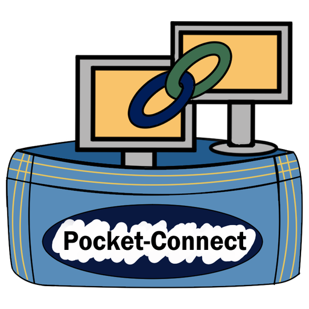

# Pocket-Connect

<p align="center"></p>

Secure remote desktop and remote console for **Windows**, **Linux** and **Android**, in the spirit of TeamViewer and Jump Desktop, with a server you host yourself.

- **Remote desktop**: see and control another computer's screen, with multiple monitors, quality presets, shared clipboard and special keys (Ctrl+Alt+Del, Alt+Tab, Win+L…).
- **Remote console**: a real terminal on the other machine (PowerShell or Command Prompt on Windows, your shell on Linux), on its own or alongside the desktop.
- **Android**: control phones and tablets over USB or Wi-Fi (ADB). You get the screen, touch and swipe, typing, the hardware buttons, and an `adb shell`. A phone plugged into any Pocket-Connect computer can be reached from anywhere through that computer.
- **Internal and external networks**: direct LAN connections need no server at all. Across the internet, devices find each other by a 9-digit **Pocket ID** through your own server, with a TURN relay for strict networks.
- **Accounts**: sign in on each of your computers and they show up under *My account* with online status. Your own computers can connect to each other without a password, the device list syncs between them, and two-factor sign-in (TOTP) is available.
- **Saved devices**: OS icons (Windows, Linux, Android, macOS, other), nested **folders** with colours, drag and drop, search, tile or list view.
- **Passwords**: a **one-time password** that changes after every session, plus an optional **permanent password** for unattended access (like TeamViewer's).
- **Secure by design**: everything is end-to-end encrypted, and passwords are never sent over the network (see [Security](docs/SECURITY.md)).

| | |
|---|---|
| Author | Pocket-Designs · pocket-designs@proton.me |
| Licence | Code: MIT. Icon artwork: © MJO-Art, all rights reserved (see [LICENSE](LICENSE)) |
| Icon | by MJO-Art (workmjo@gmail.com) |
| Platforms | Windows 10/11 (x64), Linux (x64, X11 session for full control), Android 5+ via ADB |

## Repository layout

```
app/        Electron desktop app (host + viewer in one)
  main/     main process: server link, LAN, passwords, input, terminal, Android/ADB
  ui/       pages: main window, viewer, hidden host page, session bar
  test/     protocol and security tests (node --test)
server/     self-hosted server: accounts, devices, address book, signalling (Node 22, SQLite)
deploy/     docker-compose stack for a Proxmox VM: server + Caddy (HTTPS) + coturn (relay)
docs/       user guide, server setup, security notes
.github/    GitHub Actions: tests, Windows/Linux installers, server image, releases
```

## Quick start

**Use it on one network (no server):** install the app on two computers, open *Nearby* or type the other computer's IP address, then enter the password shown on that computer.

**Use it anywhere:** run the server ([docs/SERVER-SETUP.md](docs/SERVER-SETUP.md)), then enter its address in each app under *Account*. Each computer gets a Pocket ID.

Full instructions for everyday use are in the [User Guide](docs/USER-GUIDE.md).

## How it works

```
 Viewer app ──── HTTPS / WebSocket ────► Your server ◄──── WebSocket ──── Host app
     │           (sign-in, IDs, set-up messages only)                        │
     │                                                                       │
     └─────────── WebRTC: screen, input, console, Android (DTLS) ────────────┘
                  direct when possible, otherwise via your TURN relay
                  (the relay only ever sees encrypted packets)

 On a LAN, the viewer talks straight to the host on port 47100 and the server is not used.
```

## Building from source

Requirements: Node.js 22, plus on Linux `libxtst-dev libpng-dev` and build tools.

```bash
cd app
npm ci
npm start                 # run the app
npm test                  # protocol/security tests
npm run dist:linux        # AppImage + .deb  -> app/dist
npm run dist:win          # .exe installer + .msi (run on Windows)

cd ../server
npm ci && npm test && npm start
```

Every push to GitHub runs the tests and checks that the Windows and Linux builds work, without storing anything. To get installers:

- **A release (recommended):** tag a version and push it, for example `git tag v0.1.0 && git push --tags`. The Windows (.exe, .msi) and Linux (.AppImage, .deb) installers are attached to a new page under *Releases*. Release files don't count towards GitHub's Actions storage limit.
- **A quick test build:** *Actions* tab → *Build* → *Run workflow*. The installers appear under *Releases* as a pre-release called **Test build**, which is replaced each time you run it.

The workflow never stores build artifacts, so it doesn't use GitHub's Actions storage allowance.

Run two copies on one machine for testing with `npm start -- --profile=second` (set a different LAN port in the second copy's Settings).

## Known limits (version 0.1)

- **Windows:** the host runs as a normal app, not a system service, so it cannot control the Windows sign-in screen or UAC prompts. Sign in first, and use the permanent password plus *Start with my computer* for unattended access.
- **Linux on Wayland:** screen sharing asks for permission each time, and remote mouse/keyboard needs an X11 session (e.g. "Ubuntu on Xorg").
- **Android screen** is sent as still images (about 3–8 per second over USB), which is fine for support work. For smooth full-speed video on the same computer, Pocket-Connect can launch [scrcpy](https://github.com/Genymobile/scrcpy) if it is installed.
- **Being controlled from Android:** this version controls Android devices from the desktop. A native Android app (to share an Android screen without a computer, or to control computers from a phone) is planned.
- **macOS:** not built or tested yet, although most of the code is cross-platform.
