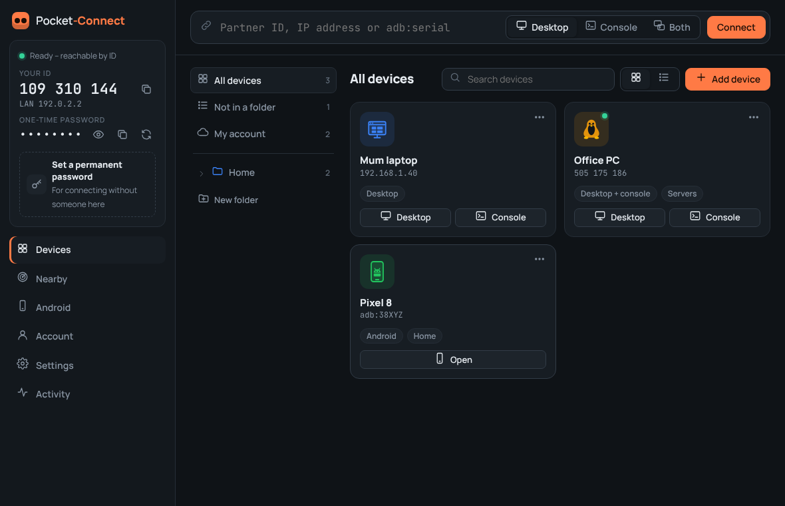
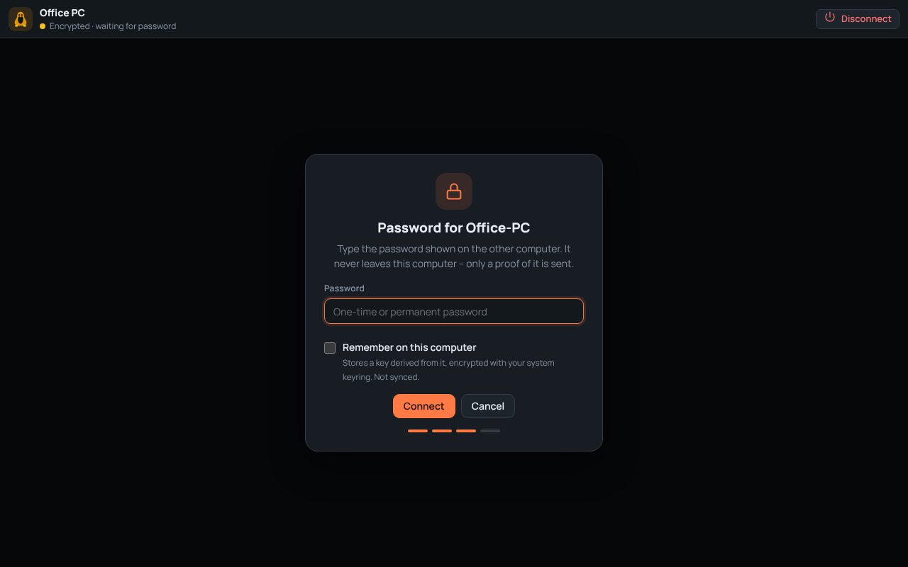
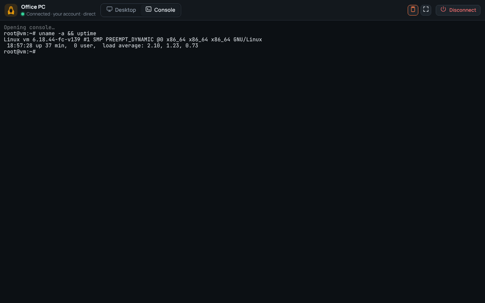
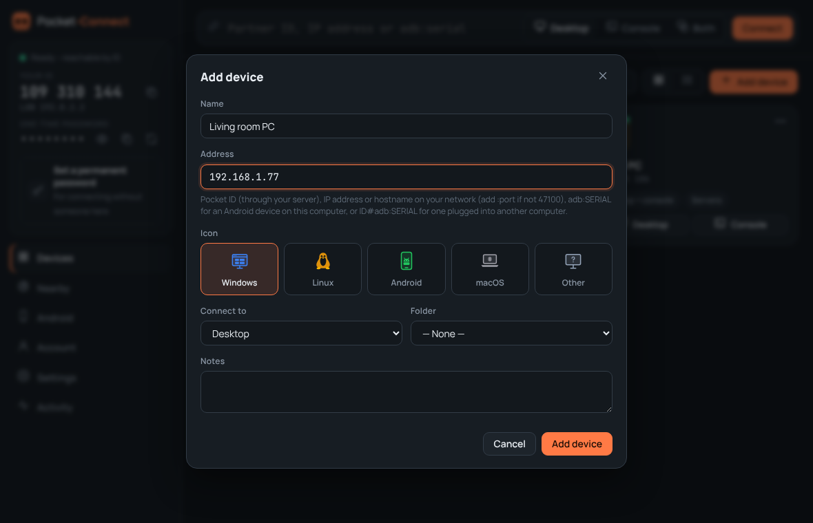
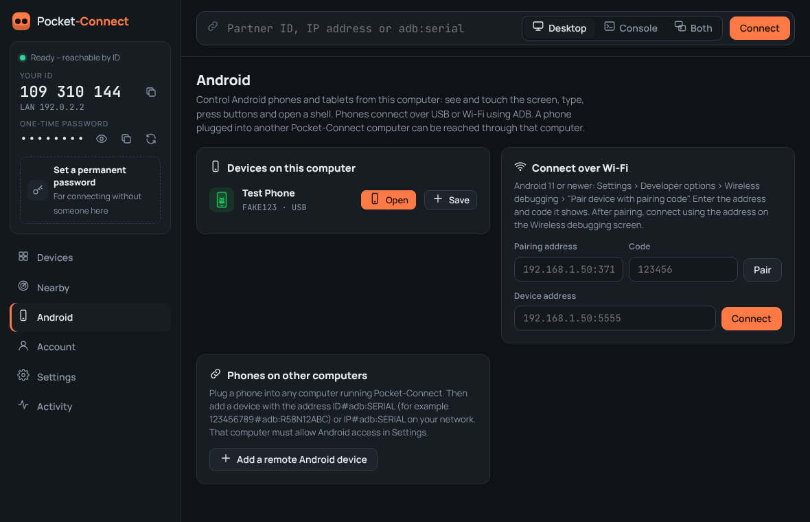
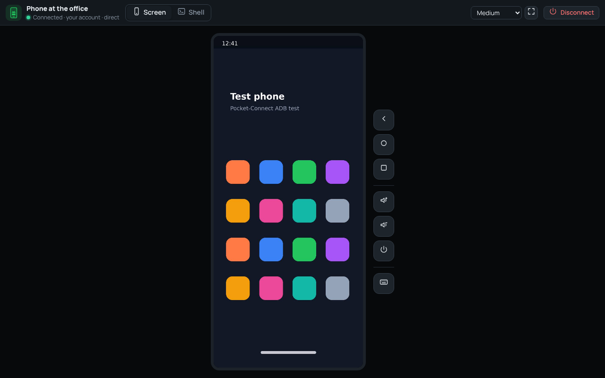
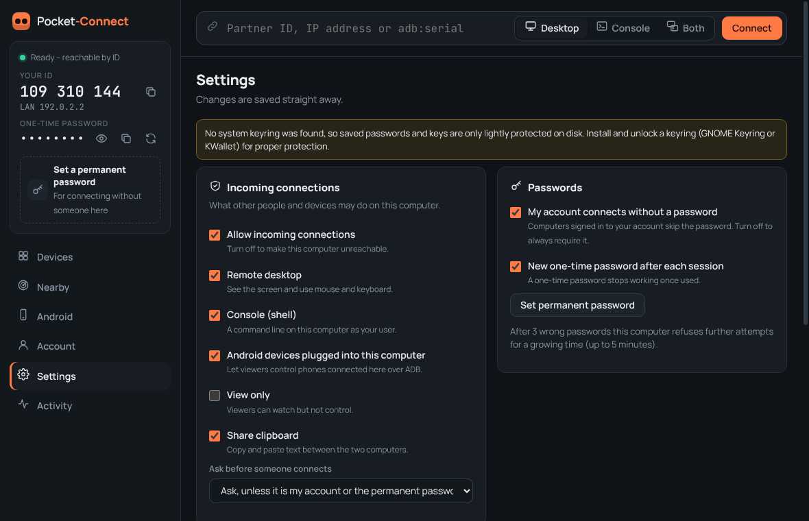
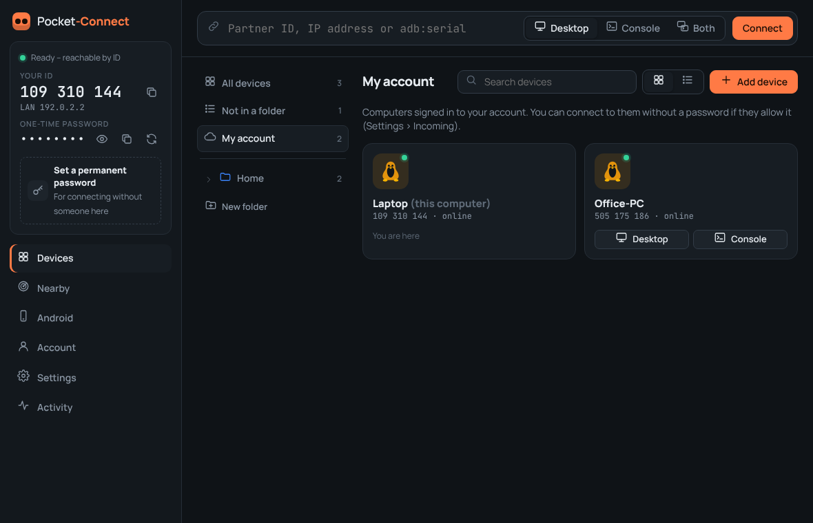

# Pocket-Connect User Guide

Pocket-Connect lets you use another computer or Android phone as if you were sitting in front of it. You can see its screen, use its mouse and keyboard, or open its command line.

---

## 1. Install

**Windows:** run `Pocket-Connect-Setup-x.y.z.exe` (or the `.msi`) and follow the steps. Pocket-Connect starts from the Start menu.

**Linux:** either
- the **AppImage**: make it executable (`chmod +x Pocket-Connect-*.AppImage`) and double-click it, or
- the **.deb** (Ubuntu, Debian, Mint, Pop!_OS…): `sudo apt install ./Pocket-Connect-*.deb`.

Install Pocket-Connect on **every** computer you want to reach, and on the ones you connect from. The same app does both.

> **Linux tip:** for full remote control, sign in to an **X11 / Xorg** session (at the login screen choose e.g. "Ubuntu on Xorg"). On Wayland, others can see your screen but not control it.

---

## 2. The main window



On the left is **this computer**:

| Item | What it is |
|---|---|
| **Your ID** | A 9-digit number like `505 175 186`. Give it to someone so they can reach this computer from anywhere. (It only appears once a server is set up; see section 7.) |
| **LAN address** | Your address on the local network. People on the same network can connect using it, with no server needed. |
| **One-time password** | Changes after each session. Read it out to someone you are helping. Click the eye to show it, the copy icon to copy it, and the arrows to make a new one. |
| **Permanent password** | Your own password for reaching this computer when nobody is there. Click the box to set or change it. |

The green dot at the top shows whether this computer can be reached:
- 🟢 **Ready – reachable by ID**: connected to your server.
- 🟡 **Local network only**: no server, so it is reachable by LAN address only.
- 🔴 **Incoming connections off** or **server unreachable**.

---

## 3. Connecting to another computer

1. Type the other computer's **ID** (e.g. `505 175 186`) or **IP address** (e.g. `192.168.1.20`) in the box at the top.
2. Choose what you want:
   - **Desktop**: see and control the screen.
   - **Console**: the command line (PowerShell / Command Prompt on Windows, the terminal on Linux).
   - **Both**: switch between them with the tabs at the top of the window.
3. Click **Connect**.
4. Type the **password** shown on the other computer (its one-time password, or its permanent password).
   - Tick **Remember on this computer** to skip this next time. (Pocket-Connect stores a key made from the password, encrypted by your system keyring, never the password itself.)
5. If the other computer is set to ask first, someone there clicks **Allow**.

### In the remote desktop window

| Button | Does |
|---|---|
| **Screen list** | Pick which monitor to see (only shown when there are several). |
| **Speed / Balanced / Best quality** | Trade picture sharpness for smoothness on slow connections. |
| Two-screens icon | Switch between *fit to window* and *actual size* (scroll around). |
| Eye icon | **View only**: stop sending your mouse and keyboard. |
| Keyboard icon | Send **Ctrl+Alt+Del**, **Alt+Tab**, **Alt+F4**, the **Windows key**, **Win+L**, **Print Screen**, or type out your clipboard. |
| Clipboard icon | Share copy and paste between the two computers (on by default). |
| Corners icon / **F11** | Full screen. Move the mouse to the top edge to bring the toolbar back. |
| **Disconnect** | End the session. |

Click inside the picture first so your keyboard goes to the other computer.



### In the console



It behaves like a normal terminal. **Ctrl+Shift+C** copies and **Ctrl+Shift+V** pastes. When the shell exits, press **Enter** to open a new one.

---

## 4. Saving devices, icons and folders

Click **Devices** in the left menu.

- **Add device**: give it a name, its address (ID, IP address, or Android serial), an **icon** (Windows, Linux, Android, macOS or Other), what to open by default, a folder, and notes.
- **Folders**: click **New folder** and pick a name and colour. Folders can go inside other folders. Right-click a folder to rename it, change its colour, add things inside it, or delete it. Deleting a folder never deletes devices; they move up one level.
- **Move devices** by dragging a device tile onto a folder (in the tiles or in the list on the left).
- **Connect** with the Desktop / Console buttons on each tile, or double-click it.
- Click the **⋯** on a tile (or right-click it) to edit, copy the address, forget a saved password, or delete it.
- Use the **search box** to find devices by name, address, notes or system, and switch between **tiles** and **list** at the top right.



When you are signed in to an account (section 7), your saved devices and folders are kept in sync on all your computers. Saved passwords are **not** synced; they stay on the computer where you saved them.

---

## 5. Android phones and tablets

Pocket-Connect controls Android devices from your computer using Google's free **ADB** tool.

### One-time setup

1. Download **Android platform-tools** (the *Android* page has a button for it), unzip it anywhere, then click **Find adb on this computer…** and pick the `adb` (or `adb.exe`) file. If you already have Android Studio, Pocket-Connect usually finds adb by itself.
2. On the phone, turn on **Developer options**: *Settings › About phone* and tap **Build number** 7 times.
3. In *Settings › System › Developer options*, turn on **USB debugging** (and **Wireless debugging** if you want Wi-Fi).



### Connect with a USB cable

Plug the phone in. Unlock it and tap **Allow** on the "Allow USB debugging?" message (tick *Always allow from this computer*). It appears on the **Android** page. Click **Open**.

### Connect over Wi-Fi (Android 11 or newer)

1. On the phone: *Developer options › Wireless debugging › Pair device with pairing code*.
2. In Pocket-Connect's **Android** page, type the **pairing address** and **code** it shows and click **Pair**.
3. Then type the **IP address & port** shown at the top of the Wireless debugging screen and click **Connect**.

### Using the phone



- **Click** to tap, **click and drag** to swipe, **click and hold** for a long press, and use the **mouse wheel** to scroll.
- **Type** on your keyboard. Enter, Backspace and the arrow keys work too, and **right-click** is the Back button.
- The buttons beside the phone are **Back**, **Home**, **Recent apps**, **Volume up/down**, **Power**, and **Type text**.
- The **Shell** tab opens a command line on the phone (`adb shell`).
- **Small / Medium / Large / Full** changes the picture size. Smaller is faster.
- If you have **scrcpy** installed, the **scrcpy** button opens a smooth full-speed video window.

### A phone plugged into a different computer

Plug the phone into any computer running Pocket-Connect (it must have adb set up and *Android devices plugged into this computer* allowed in its Settings). Then on your computer **Add device** with the address:

```
<that computer's ID>#adb:<phone serial>     e.g.  505175186#adb:R58N12ABC
<that computer's IP>#adb:<phone serial>     e.g.  192.168.1.20#adb:R58N12ABC
```

The phone's serial is shown on that computer's **Android** page.

---

## 6. Letting others connect to this computer

Go to **Settings › Incoming connections**:

| Setting | Meaning |
|---|---|
| Allow incoming connections | Master switch. Off means nobody can connect. |
| Remote desktop / Console / Android devices | What people may use. |
| View only | They can watch but not control. |
| Share clipboard | Copy and paste between the computers. |
| Ask before someone connects | *Never*, *Ask unless it's my account or the permanent password* (default), or *Always*. If nobody answers within 30 seconds, the request is declined. |

While someone is connected, a small **orange bar** stays at the top of your screen showing who it is, with an **End** button. They are also listed at the bottom left of the main window. You can disconnect anyone at any time.



**Unattended access** (e.g. your own PC at home):
1. Set a **permanent password** (long and unique; a few random words is ideal).
2. In *Settings › General*, turn on **Start with my computer**.
3. Closing the window keeps Pocket-Connect running in the system tray. To stop it, use **Quit** in the tray menu.

> **Windows note:** Pocket-Connect cannot see or control the Windows sign-in screen or "Do you want to allow this app…" (UAC) prompts. Leave the PC signed in (you can lock it with Win+L; you'll see the lock screen but cannot type the PIN remotely in this version).

---

## 7. Server and account

A server lets your devices reach each other **over the internet by ID**, and gives you an **account**. You run it yourself, for example on a Proxmox VM (see [SERVER-SETUP.md](SERVER-SETUP.md)).

### Connect the app to your server

1. **Account** page › **Server address**: type it, e.g. `https://connect.example.com`.
2. Click **Check**. You should see "Found Pocket-Connect server".
   - If you made your own certificate for a LAN-only server, the check shows its **SHA-256 fingerprint**. Compare it with the one printed by `make-cert.sh` on the server. If they match, click **Pin this certificate**.
3. Click **Save**. This computer gets its **ID** and the dot turns green.

### Account

- **Create an account** (the first account on a new server becomes the administrator; by default nobody else can sign up).
- **Sign in** with the same account on each of your computers. They appear under **Devices › My account** (below) with a green dot when online, and can connect to each other **without passwords** (you can turn that off in *Settings › Passwords*).

  

- **Turn on two-factor**: scan the QR code with an authenticator app (Aegis, 2FAS, Google or Microsoft Authenticator) and enter the code. After that you need the 6-digit code when signing in.
- **Sign out everywhere** if a computer is lost or stolen. It signs out all devices and they need the password again.
- **Recent account activity** shows sign-ins, failed sign-ins and connection requests with their IP addresses.

---

## 8. Troubleshooting

| Problem | Try |
|---|---|
| "That device is offline or the ID is wrong" | Check the other computer shows a green dot and the same server address. |
| "Could not reach that address" on the LAN | Allow Pocket-Connect through the firewall: **TCP 47100** and **UDP 47101**. On Windows, accept the firewall prompt the first time (Private networks). |
| Connects, then "The connection was lost" between different networks | The server's **TURN relay** is missing or blocked. See SERVER-SETUP.md (UDP/TCP 3478 and UDP 49160–49200 must be forwarded). |
| Black screen on Linux | You are on Wayland and need to approve sharing, or are logged out. Use an Xorg session. |
| Mouse/keyboard don't work on Linux | Wayland session; switch to Xorg. Also check *View only* is off on both sides. |
| "Too many wrong passwords" | The computer locks out for a short while after 3 wrong tries. Wait and try again. |
| Android shows "unauthorized" | Unlock the phone and accept the USB debugging prompt. |
| Android picture is slow | Choose *Small* size, use USB rather than Wi-Fi, or use **scrcpy**. |
| "No system keyring was found" (Linux) | Install/unlock GNOME Keyring or KWallet so saved keys are encrypted properly. |

---

Pocket-Connect © 2026 Pocket-Designs · pocket-designs@proton.me · MIT licence · Icon artwork © MJO-Art
